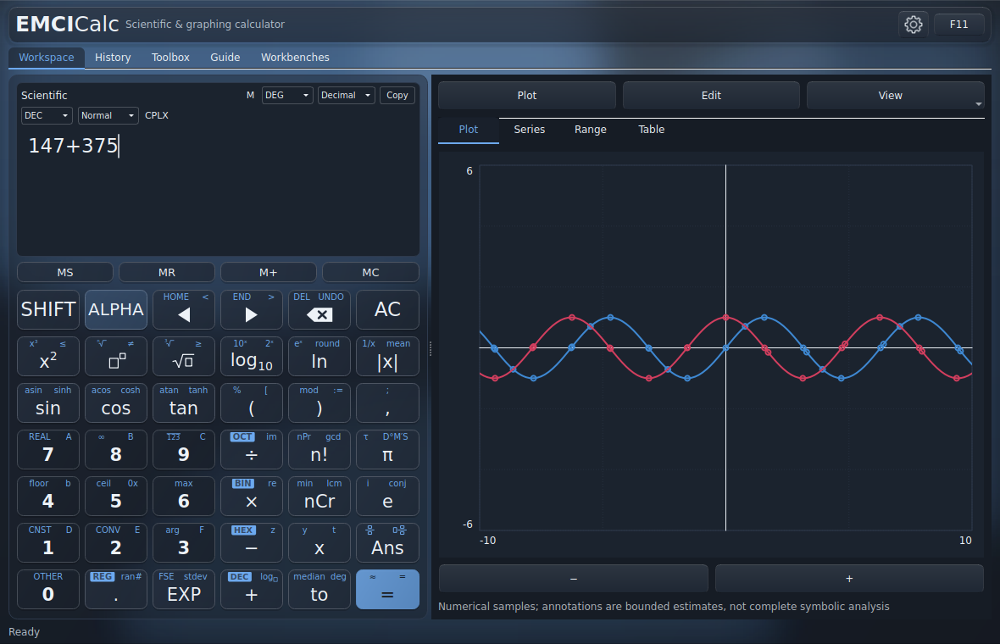

Desktop mode provides a calculation area and companion workbenches. Depending on window size and layout, tools appear alongside the keypad or in the available workspace tabs. The top navigation gives access to Workspace, History, Toolbox, Guide and Workbenches. The gear opens Settings.

*Desktop overview: use the expression area to enter mathematics, the mode controls to choose interpretation, and the graph workspace to explore sampled curves. The memory strip is separate from the numeric keypad.*

Choose **Mode → Calculator** in Settings for the compact calculator interface. It provides the same calculation engine, with a calculator display, keypad and MENU navigation. Desktop and Calculator remember their own appearance and window size. Minimum sizes are 680 × 540 for Desktop and 320 × 540 for Calculator.

**Workbenches** in Desktop, or **MENU** in Calculator, groups destinations under:

| Category | Destinations |
| --- | --- |
| Calculate & explore | Calculate, Details, Algebra / Calculus, Steps, Graph / Table |
| Data & tools | Matrix, Data / Statistics, Finance, Programmer, Toolbox |
| Saved workspace | History, Definitions, Export workspace, Import workspace |
| Personalize | Input modes, Keypad designer, Settings, Guide |

Use Back to return through Calculator pages. Keyboard focus stays within the relevant tool: typing into a graph field or a history search does not activate calculator keypad shortcuts.

---

[Previous: Install and start](01-install.md) · [Manual contents](./) · [Next: Make your first calculation](03-first-calculation.md)
