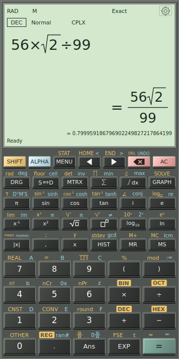

1. Open Calculate, or press **Ctrl+L** to select the calculator expression.
2. Type `1/3+1/6`.
3. Press **Enter** or click the equals key. Exact mode displays `1/2`.
4. Use **S⇔D** to display the stored answer as a decimal: `0.5`.
5. Use **Ans** in your next expression, for example `Ans*6`, then evaluate to obtain `3`.

An equals sign typed with the physical keyboard is equation text; **Enter** performs evaluation. **AC** clears the active expression/output. It does not erase independent saved history or registers. A blank startup display is intentional; the application does not invent a zero result.

## Exact, decimal and approximation markers

**Exact** retains simplified fractions, radicals and symbolic quantities where possible. **Decimal** requests a numerical presentation. The marker **=** means the displayed value is exact; **≈** means it is approximate. The marker applies to the displayed value, not merely to the appearance of the digits.

For `sqrt(2)`, the exact answer is a radical and its decimal is approximate. For `1/3`, a complete repeating cycle can be shown with an overline and **=**. If the selected digit budget cannot show the complete cycle, the application uses a rounded approximation. Copying a recurring answer preserves its exact rational value.

**S⇔D reformats the stored answer without calculating again.** This matters for random expressions and answers that depend on changing variables. In contrast, SHIFT then equals (**≈**) evaluates the expression again in Decimal mode. **F5** switches the result mode.

*The input, exact result and secondary decimal presentation are distinct. The RAD/DEG indicator belongs to angle interpretation; it does not determine whether a number is exact.*

Settings offers **Exact fractions → Improper / Mixed**. Significant digits controls general numerical precision, from 10 to 200 digits; it is different from **FIX decimal places**, which controls fixed decimal presentation.

## Angle and number domain

Check **DEG**, **RAD** or **GRAD** before using trigonometry. **F4** cycles the angle mode. In DEG, `sin(30)` is `1/2`; in RAD, use `sin(pi/6)` for the corresponding angle. Explicit angle units such as `90 deg` and `pi rad` make an expression's intent clear.

**REAL / CPLX** controls the number domain. Choose complex numbers when a calculation requires `i`, such as `sqrt(-1)`. A principal square root is not an equation's complete set of roots: solving `x^2=4` and evaluating `sqrt(4)` are different tasks.

---

[Previous: Get oriented](02-interface-tour.md) · [Manual contents](./) · [Next: Enter and edit mathematics](04-editing.md)
