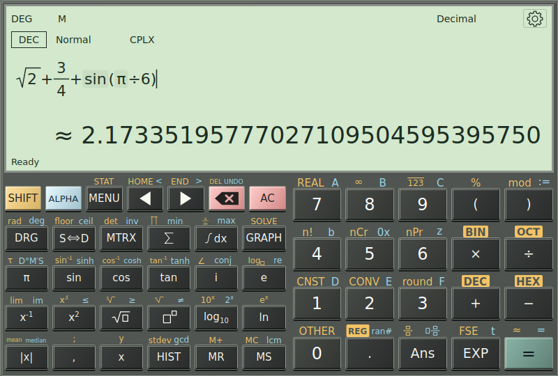

**Natural** input displays editable fractions, powers, roots and boxed arguments. **Linear** input uses ordinary text syntax. Choose **Input style** in Settings. Results retain mathematical typesetting in either mode.

Function keys insert templates with empty arguments, not example numbers. Fill every required slot. **Tab / Shift+Tab** visits empty slots; **Left / Right** moves through structures. Press Right to leave an exponent before adding a term outside it. At the end of a completed fraction denominator, + or − begins the next term; use parentheses when the denominator itself is a sum.

For example, enter `(1+2)/(3+4)` in Linear input to obtain `3/7`. In Natural input, a fraction template makes the numerator and denominator separate editing areas. SHIFT then **Ans** inserts a fraction template; ALPHA then **Ans** inserts a mixed fraction. The ordinary divide key enters inline division.

Use **Shift+Enter** for a visual line break within one expression. **Up / Down** navigates visual lines. Standard copy, paste, cut, select-all, undo and redo shortcuts remain available. Right-click offers context actions; read-only results provide copying without mutation actions.

**F1** inside a function call or on a catalog entry opens argument guidance. This is the best way to check the required argument order, optional parameters and their meaning. Use explicit parentheses and multiplication when an expression could be read in more than one way.

## SHIFT, ALPHA and REG

Gold legends identify SHIFT functions; blue legends identify ALPHA functions. Clicking the layer key arms a one-shot alternate action. A quick unused physical Shift or Alt tap also toggles a layer when calculator controls have focus. Holding the modifier keeps its layer active until release. **F2** and **F3** toggle SHIFT and ALPHA directly.

The same physical digit position activates its displayed alternate function. The active caption enlarges on the key, so check it before selecting. Shift+arrow text selection and ordinary tool-field editing keep their usual meanings.

SHIFT then the decimal key enters **REG**. Digits then insert atomic **R0–R9** references, and REG remains active for further register entry. The decimal key, a deliberate Shift, or Escape exits REG without clearing the expression. REG inserts a register reference; it does not store a new value in that register.

Calculator offers **Pocket**, **Compact** and **Expanded** keypads. Pocket has fewer direct keys, so some functions use alternate layers. All layouts keep access to argument guidance and the Toolbox. In landscape, the keypad rearranges into banks while retaining the chosen layout's actions.

## Bases, formatting and previews

Choose **BIN**, **OCT**, **DEC** or **HEX** for base 2, 8, 10 or 16. Fractional values are supported. In HEX, `FF+1` gives `100`. ALPHA provides hexadecimal letters in the applicable layouts, and explicit binary/hexadecimal prefix actions are available. The Programmer workbench is the separate choice for fixed-width integer operations.

Digit grouping and decimal separators change presentation; saved canonical expressions retain consistent punctuation. With decimal-comma input enabled, a typed decimal comma maps to the canonical decimal point; semicolon within function arguments supplies an argument comma. The dedicated comma action explicitly inserts an argument separator.

**Continuous evaluation** is off by default. Enable it to preview complete expressions after a short pause. Previewing does not commit Ans, history or registers. Press Enter to confirm a calculation. Empty, incomplete or invalid input leaves the preview blank instead of displaying an old answer.

---

[Previous: Make your first calculation](03-first-calculation.md) · [Manual contents](./) · [Next: Reuse answers, history and registers](05-history-memory.md)
