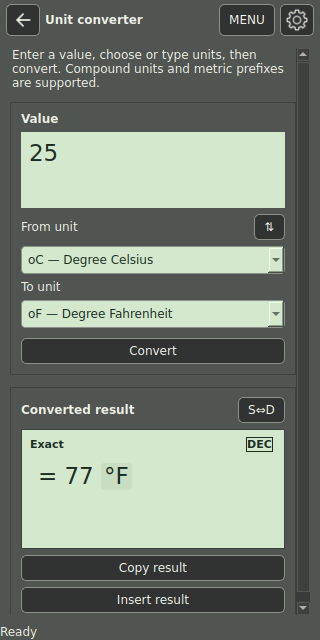

## Unit conversion

1. Open **Toolbox → Unit conversion**.
2. Enter a value, such as `25`.
3. Choose **From unit → °C — Degree Celsius**.
4. Choose **To unit → °F — Degree Fahrenheit**.
5. Select **Convert**. The result is `77 °F`.
6. Use **Copy result** or **Insert result** as needed.

The converter supports compatible units, including compound units and metric prefixes. Pick the actual source and destination quantities; an incompatible-dimension error is not a rounding problem. The converter has its own exact/decimal result presentation.

## Currency conversion

Open **Currency converter**, enter the amount and choose source and destination currencies. Check the displayed rate date and source. Refresh obtains the ECB reference feed over HTTPS when a connection is available. A last-good cached rate set remains available after a failed refresh; the displayed date lets you judge its age.

Currency results use the selected snapshot, not a live trading quote. Conversion fees and an offered transaction rate belong in the separate Finance currency-after-fees worksheet. When no usable rate is available, refresh or choose a supported currency; changing numerical precision cannot supply a missing rate.

---

[Previous: Reuse answers, history and registers](05-history-memory.md) · [Manual contents](./) · [Next: Plot a curve and read a table](07-graphs-tables.md)
