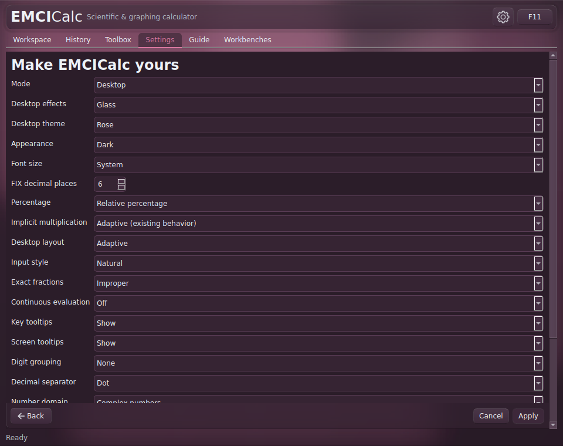
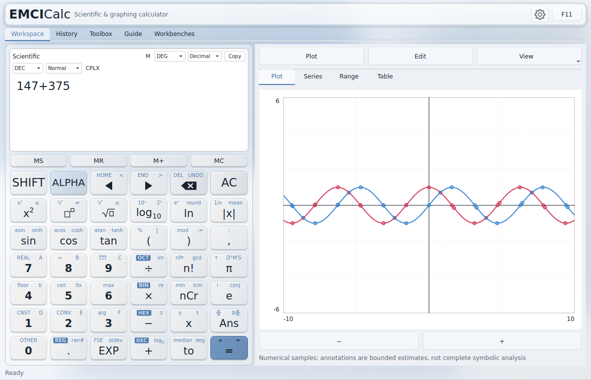

Open the gear or press **Ctrl+,**.

**Desktop Settings stages changes:** choose **Apply** to retain them, or **Cancel** to discard the staged set. **Calculator Settings accepts changes immediately.** Do not assume that leaving a Calculator settings page will undo a choice.

Desktop has eight palettes and Flat, Glass, Raised and Frosted Glass effects. **Appearance → System / Light / Dark** selects the light/dark behaviour. Calculator has eight skins, including Classic, Modern Light, Modern Dark and AMOLED, and three keypad layouts. Each mode retains its own appearance.

**Font size** offers System, Small, Medium and Large. It adjusts nominal interface text while retaining operating-system DPI behaviour. Long expressions and tool panels scroll or pan locally. Key tooltips and Screen tooltips have separate controls; F1 on a focused keypad key can show its layer meanings when key tooltips are enabled.

The nine interface languages are English, Hungarian, German, French, Spanish, Italian, Russian, Simplified Chinese and Japanese. Bundled Noto Sans CJK fallback fonts support the Japanese and Chinese interfaces where system fonts are incomplete.

*Light appearance retains the same calculation and graph controls.*

---

[Previous: Customize your working method](09-input-workflows.md) · [Manual contents](./) · [Next: Save, export and back up](11-save-restore.md)
